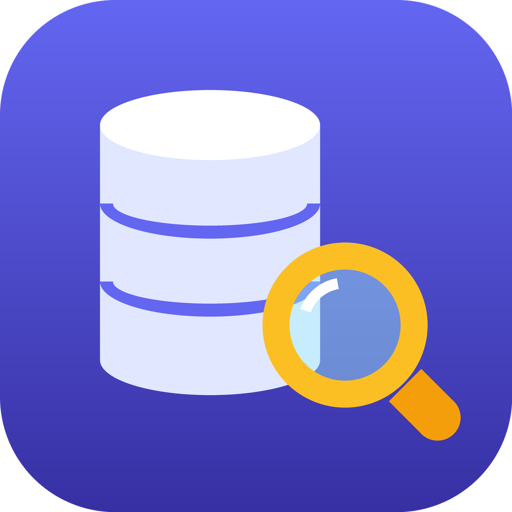

<p align="center"></p>

# Database Explorer

A read-only browser for the **PostgreSQL** and **MySQL** databases on your own computer.
Download it, double-click it, and look through your tables in the browser — nothing to install,
and it never changes your data.

## Download and run (Windows)

1. Open the **Releases** page of this repository (right-hand side of the repository page) and
   download **`DatabaseExplorer.exe`** from the latest release.
2. Double-click it. A small window opens and your browser shows the app.
   - Windows may say **"Windows protected your PC"** because the app isn't signed with a paid
     certificate. Click **More info → Run anyway**.
3. Log in to your database server (usually host `localhost`, with your PostgreSQL or MySQL
   username and password), pick a database, and explore.
4. To stop the app, close the small window.

Everything stays on your computer: the app only accepts connections from your own machine,
your password is only kept in memory while the app runs, and only the connection details
(never the password) are remembered for next time.

## Features

- Dashboard of tables **and views** with estimated row counts and sizes; sort by name, rows or size.
- Sidebar list of every table for quick switching; PostgreSQL schema switcher.
- Table data: search all columns, **filter per column** (contains; start with `=` for exact), **click a header to sort**, paging.
- **Foreign-key values are links** to the referenced row. **Click a row** to see every field in full (JSON pretty-printed, copy as JSON).
- **Structure tab**: columns (type, nullable, default, PK/FK), foreign keys, indexes.
- **Export CSV** of the current search/filters/sort (up to 50,000 rows).
- **SQL Console** (read-only): one statement at a time (SELECT, WITH, SHOW, EXPLAIN…), run in a read-only transaction that is always rolled back; shows up to 1,000 rows.
- Dark mode, and the address keeps page / search / sort / filters, so views can be bookmarked.

---

## For developers

React (Vite) frontend + Flask backend.

### Run from source (PowerShell)

Backend:
```powershell
cd backend
python -m venv venv
.\venv\Scripts\Activate.ps1
pip install -r requirements.txt
python app.py               # http://localhost:5000
```

Frontend (new terminal):
```powershell
cd frontend
npm install
npm run dev                 # http://localhost:5173
```

### Build the .exe

```powershell
powershell -ExecutionPolicy Bypass -File packaging\build.ps1
```

Creates `release\DatabaseExplorer.exe` (it uses its own build environment in `packaging\.venv`,
so it doesn't touch `backend\venv`). The logo is drawn by `packaging\make_icons.py`.
Before a new release, bump the version in `backend\app.py` and `packaging\version_info.txt`.

### Tests

```powershell
cd backend; .\venv\Scripts\python.exe -m unittest discover -s tests -t .
```

### Notes

- Read-only: PostgreSQL read-only session, MySQL `SET SESSION TRANSACTION READ ONLY`.
- The server only answers on `127.0.0.1` and rejects requests whose host name isn't `localhost`/`127.0.0.1` (blocks DNS-rebinding attacks from other websites). The packaged app allows no cross-origin requests.
- The packaged app runs on the first free port from 52300; double-clicking it again reuses the running copy.
- Saved connections are forgotten after 8 hours unused (`CONNECTION_IDLE_HOURS`, `0` = never).
- Database connections are reused between requests (up to 4 per login, closed after 5 minutes idle).
- Tables over ~100,000 rows show an estimated total when nothing is filtered; **count exactly** gets the real number.
- Query timeout: 15 s (`QUERY_TIMEOUT_MS`, `0` = no limit).
- Debug mode is off by default; for development: `$env:FLASK_DEBUG = "1"; python app.py`.
- MySQL: schema = database name. PostgreSQL: schema defaults to `public`.
